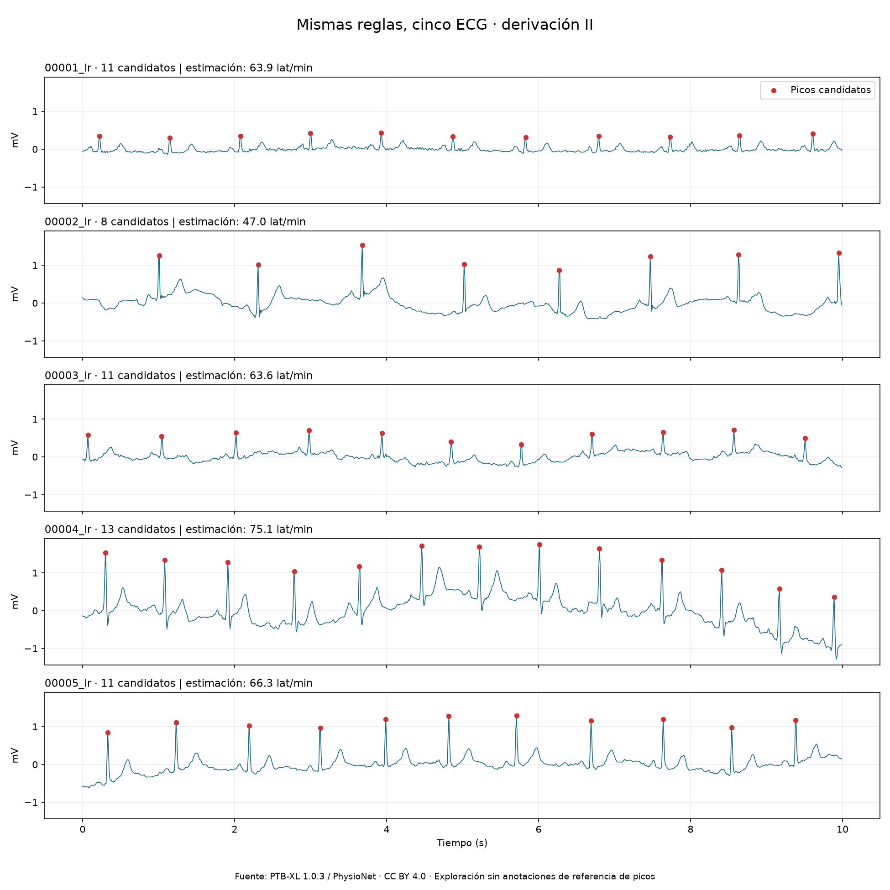
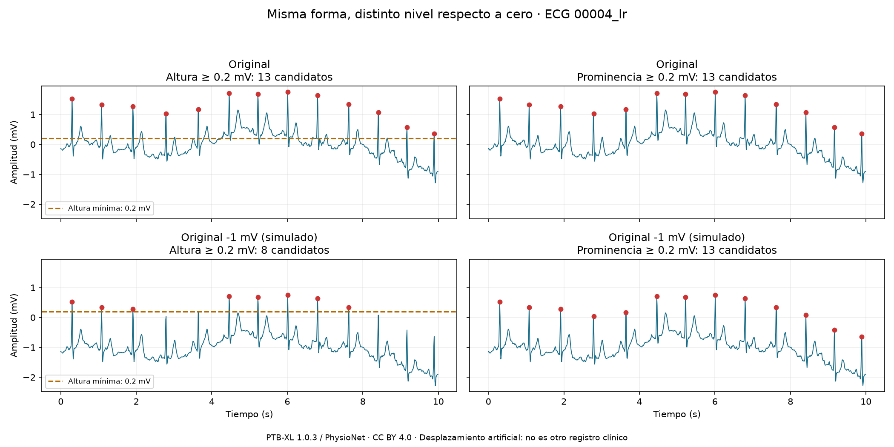

# CardioSignal

**Proyecto en desarrollo — Exploración de ECG y detección de picos.**

Proyecto de aprendizaje en Python que conecta física y procesamiento de
señales. El objetivo a largo plazo es estudiar la clasificación de ECG y su
robustez frente al ruido.

Esta versión carga un registro real de PTB-XL, representa la derivación II,
detecta máximos candidatos a picos R y calcula los intervalos entre ellos.
**Todavía no hay un modelo de machine learning entrenado. No es una herramienta
de diagnóstico ni está validada para uso clínico.**

## Ejemplo


Resultados del registro `00001_lr` con los parámetros actuales:

| Medida | Resultado |
| --- | --- |
| Duración | 10 s |
| Frecuencia de muestreo | 100 Hz |
| Matriz de señales | 1.000 muestras × 12 derivaciones |
| Picos candidatos en la derivación II | 11 |
| Intervalos RR | 10 |
| RR medio | 0,939 s |
| Frecuencia estimada | 63,9 latidos/min |
| RR mínimo / máximo | 0,91 / 0,97 s |

Estos son resultados descriptivos de un registro, no métricas de precisión
ni evidencia de generalización a otros pacientes.

## Ejecutar en Windows y VS Code

Requisitos: Python 3.13 y conexión para instalar dependencias y descargar el
registro. Abre esta carpeta en VS Code y una terminal PowerShell:

```powershell
py -3.13 -m venv .venv
.\.venv\Scripts\python.exe -m pip install -r requirements-lock.txt
.\.venv\Scripts\python.exe primer_ecg.py
```

Si el entorno ya existe, solo necesitas el último comando. No hace falta
activar el entorno ni cambiar la política de ejecución de Windows.

Se descargan únicamente los archivos `.hea` y `.dat` de un registro a
`data/sample/`. Las ejecuciones posteriores los reutilizan. Los gráficos se
guardan en `figures/primer_ecg.png` y `figures/intervalos_rr.png`.

`requirements.txt` declara las dependencias directas; `requirements-lock.txt`
recoge las versiones del entorno probado. VS Code está configurado para usar
`.venv/Scripts/python.exe`.

## Práctica 2: comparar cinco ECG

```powershell
.\.venv\Scripts\python.exe comparar_ecgs.py
```

Aplica las mismas reglas a los registros `00001_lr` a `00005_lr`, sin ajustar
los parámetros individualmente. Genera `figures/comparacion_ecgs.png` y
`reports/comparacion_ecgs.json`, con los parámetros, picos e intervalos.
La descarga se limita a estos cinco registros y se reutiliza en ejecuciones
posteriores. Todos los paneles comparten escala vertical.



| Registro | Picos candidatos | Frecuencia estimada (lat/min) |
| --- | --- | --- |
| 00001_lr | 11 | 63,9 |
| 00002_lr | 8 | 47,0 |
| 00003_lr | 11 | 63,6 |
| 00004_lr | 13 | 75,1 |
| 00005_lr | 11 | 66,3 |

Son cinco registros consecutivos, no una muestra representativa ni
necesariamente cinco pacientes distintos. No usamos anotaciones de referencia
de picos: esta práctica es una inspección visual, no una evaluación de precisión.

Ejercicio: observa si cada máximo estrecho está marcado, si hay puntos sobre
otras ondas y si existen picos negativos que el detector no pueda identificar.
Compara especialmente la forma de la señal entre registros. Una frecuencia
aparentemente razonable no demuestra que las detecciones sean correctas.

## Práctica 3: altura y prominencia

```powershell
.\.venv\Scripts\python.exe altura_prominencia.py
```

Compara dos detectores sobre la derivación II de `00004_lr`: uno exige
altura mínima de 0,2 mV y otro prominencia mínima de 0,2 mV. Ambos mantienen
una distancia mínima de 0,4 s. Repite la comparación después de restar 1 mV
a todas las muestras, conservando la forma y los tiempos de la señal.



| Señal | Por altura | Por prominencia |
| --- | --- | --- |
| Original | 13 candidatos | 13 candidatos |
| Original menos 1 mV | 8 candidatos | 13 candidatos |

En la ejecución comprobada, las posiciones por prominencia coinciden exactamente
antes y después del desplazamiento.

La altura se mide respecto a cero. La prominencia se mide respecto a la línea
de contorno que define el algoritmo a partir de las bases a ambos lados del
pico. Al sumar una constante, el pico y su línea de contorno cambian en la
misma cantidad, por lo que su diferencia se conserva.

El programa compara las posiciones exactas de las detecciones por prominencia,
no solo su número. Guarda el gráfico en `figures/altura_prominencia.png` y los
parámetros y resultados en `reports/altura_prominencia.json`.

**Alcance:** es un desplazamiento constante artificial. No es una simulación
de deriva variable con el tiempo y no demuestra resistencia a todo tipo de
ruido ni que los máximos detectados sean picos R correctos. Los datos originales
permanecen intactos. No se escoge un umbral óptimo a partir de este experimento.

## Práctica 4: etiquetas y pacientes

```powershell
.\.venv\Scripts\python.exe explorar_etiquetas.py
```

Descarga únicamente `ptbxl_database.csv` y `scp_statements.csv` de PTB-XL 1.0.3
a `data/metadata/`. Lee los códigos con `ast.literal_eval`, conserva los códigos
diagnósticos y los agrupa en las cinco superclases oficiales: NORM, MI, STTC,
CD y HYP. Una clase se cuenta una sola vez por ECG, aunque tenga varios códigos.
No se aplica umbral de confianza: un `likelihood` de cero significa confianza
desconocida, no ausencia. Esta política describe anotaciones, no diagnósticos
confirmados para cada caso. Un registro sin clase diagnóstica no se convierte
en un ejemplo normal.

El resumen muestra registros, pacientes, categorías y los cinco ejemplos ya
explorados. Las categorías pueden coexistir: la futura tarea de cinco clases
sería **multietiqueta**, no una elección obligatoria de una única clase.
Las categorías no cubren todas las enfermedades cardíacas ni predicen eventos
futuros; NORM tampoco demuestra que una persona esté libre de enfermedad.

Se comprueban identificadores únicos y los folds oficiales: 1–8 para entrenar,
9 para validación y 10 para prueba. El programa se detiene si un paciente
aparece en varios folds. No se realiza una división aleatoria por registro.
Las distribuciones globales son descriptivas; el test se reservará para la
evaluación final, sin ajustar modelos o umbrales con sus resultados.

Salida: `reports/etiquetas_resumen.json`, con recuentos, política de etiquetas,
particiones y hashes SHA-256 de los archivos usados. No incluye identificadores
de pacientes ni informes clínicos. No entrena un modelo ni descarga todas las
señales. La exploración de etiquetas no sustituye la validación del detector de
picos frente a anotaciones temporales.

Resultados comprobados con esta versión:

- 21.799 ECG y 18.869 pacientes; 2.111 pacientes tienen varios registros.
- Categorías: NORM 9.514; MI 5.469; STTC 5.235; CD 4.898; HYP 2.649.
- 5.144 registros tienen varias categorías y 411 no tienen clase diagnóstica.
- Los cinco ejemplos iniciales tienen NORM y pertenecen al conjunto de entrenamiento.

| Partición oficial | Folds | ECG | Pacientes |
| --- | --- | --- | --- |
| Entrenamiento | 1–8 | 17.418 | 15.023 |
| Validación | 9 | 2.183 | 1.942 |
| Prueba | 10 | 2.198 | 1.904 |

No hay pacientes compartidos entre folds. Los recuentos anteriores son previos
a cualquier filtrado para una futura tarea de aprendizaje.

## Método

1. Leer el registro con WFDB en unidades físicas y seleccionar la derivación II.
2. Construir el eje temporal como `n / fs`.
3. Comparar una medición manual con las detecciones automáticas.
4. Buscar máximos con `scipy.signal.find_peaks`: distancia mínima de 0,4 s
   y prominencia mínima de 0,2 mV.
5. Calcular `RR = np.diff(tiempos_de_picos)` y `60 / np.mean(RR)`.
6. Representar la señal, los picos candidatos y los intervalos.

## Limitaciones

- Los umbrales se han elegido para este ejemplo. Pueden omitir picos o confundir
  otras ondas y ruido con ellos; no son parámetros clínicos universales.
- El método busca máximos positivos y no cubre todas las morfologías posibles.
- La separación mínima de 0,4 s limita las detecciones cercanas entre sí.
- Los tiempos están en una rejilla de 0,01 s, sin interpolación.
- Se han inspeccionado visualmente cinco registros. No se ha evaluado el detector frente
  a anotaciones de referencia ni medido su sensibilidad o precisión.
- Los resultados no permiten establecer aquí un diagnóstico.

## Hoja de ruta

- [x] Cargar y visualizar un ECG real.
- [x] Detectar picos candidatos y representar intervalos RR.
- [ ] Evaluar en más registros y con referencias adecuadas.
- [x] Explorar etiquetas y comprobar separación oficial de pacientes.
- [ ] Definir la tarea de clasificación y sus criterios de inclusión.
- [ ] Separar entrenamiento, validación y prueba por paciente.
- [ ] Entrenar un modelo sencillo de referencia.
- [ ] Comparar modelos y evaluar errores, ruido y calibración.
- [ ] Preparar una demo documentada.

## Datos y atribución

Fuente: [PTB-XL 1.0.3 en PhysioNet](https://physionet.org/content/ptb-xl/1.0.3/).

Wagner, P., Strodthoff, N., Bousseljot, R.-D., Samek, W., y Schaeffter, T.
(2022). *PTB-XL, a large publicly available electrocardiography dataset*
(version 1.0.3). PhysioNet. https://doi.org/10.13026/kfzx-aw45

Los datos tienen licencia [CC BY 4.0](https://creativecommons.org/licenses/by/4.0/).
Las imágenes incluidas son visualizaciones derivadas de los registros
`00001_lr` a `00005_lr`:
selección de la derivación II, marcado de máximos, cálculo de intervalos y,
en la práctica 3, desplazamiento artificial constante de -1 mV.
Estas imágenes se comparten bajo CC BY 4.0 con la atribución anterior.

Los datos descargados, los gráficos de ejecución y el entorno virtual quedan
fuera del repositorio. `docs/images/` contiene los gráficos de ejemplo.
