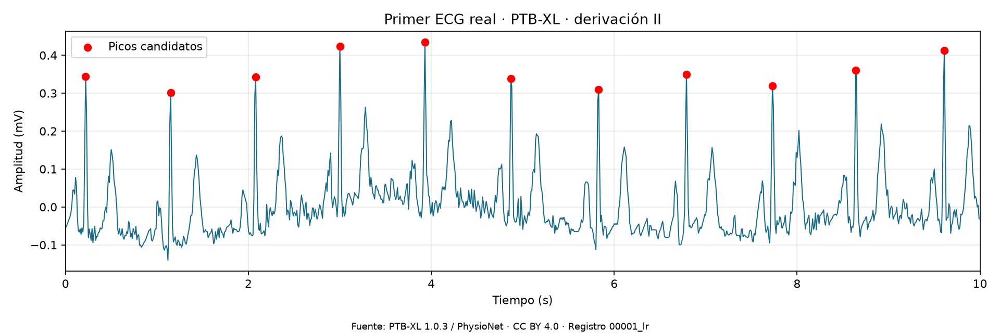
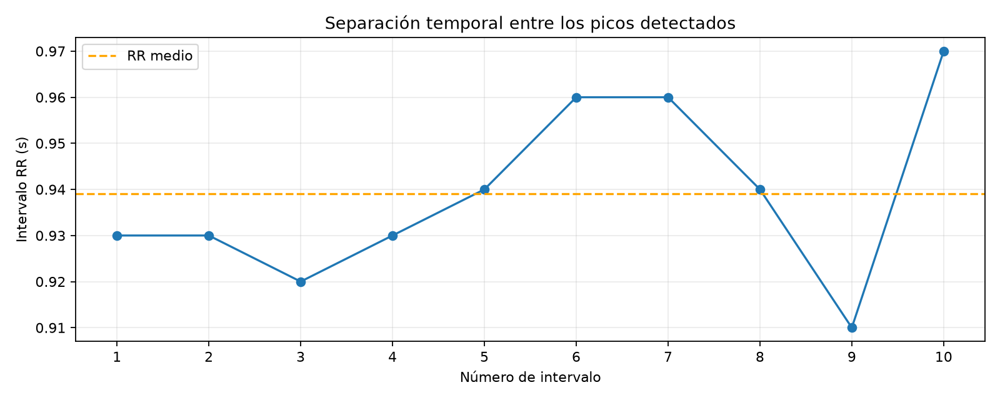

# CardioSignal

**v0.1 — Exploración de ECG y detección de picos. Proyecto en desarrollo.**

Proyecto de aprendizaje en Python que conecta física y procesamiento de
señales. El objetivo a largo plazo es estudiar la clasificación de ECG y su
robustez frente al ruido.

Esta versión carga un registro real de PTB-XL, representa la derivación II,
detecta máximos candidatos a picos R y calcula los intervalos entre ellos.
**Todavía no hay un modelo de machine learning entrenado. No es una herramienta
de diagnóstico ni está validada para uso clínico.**

## Ejemplo





Resultados del registro `00001_lr` con los parámetros actuales:

| Medida | Resultado |
| --- | --- |
| Duración | 10 s |
| Frecuencia de muestreo | 100 Hz |
| Matriz de señales | 1.000 muestras × 12 derivaciones |
| Picos candidatos en la derivación II | 11 |
| Intervalos RR | 10 |
| RR medio | 0,939 s |
| Frecuencia estimada | 63,9 latidos/min |
| RR mínimo / máximo | 0,91 / 0,97 s |

Estos son resultados descriptivos de un registro, no métricas de precisión
ni evidencia de generalización a otros pacientes.

## Ejecutar en Windows y VS Code

Requisitos: Python 3.13 y conexión para instalar dependencias y descargar el
registro. Abre esta carpeta en VS Code y una terminal PowerShell:

```powershell
py -3.13 -m venv .venv
.\.venv\Scripts\python.exe -m pip install -r requirements-lock.txt
.\.venv\Scripts\python.exe primer_ecg.py
```

Si el entorno ya existe, solo necesitas el último comando. No hace falta
activar el entorno ni cambiar la política de ejecución de Windows.

Se descargan únicamente los archivos `.hea` y `.dat` de un registro a
`data/sample/`. Las ejecuciones posteriores los reutilizan. Los gráficos se
guardan en `figures/primer_ecg.png` y `figures/intervalos_rr.png`.

`requirements.txt` declara las dependencias directas; `requirements-lock.txt`
recoge las versiones del entorno probado. VS Code está configurado para usar
`.venv/Scripts/python.exe`.

## Método

1. Leer el registro con WFDB en unidades físicas y seleccionar la derivación II.
2. Construir el eje temporal como `n / fs`.
3. Comparar una medición manual con las detecciones automáticas.
4. Buscar máximos con `scipy.signal.find_peaks`: distancia mínima de 0,4 s
   y prominencia mínima de 0,2 mV.
5. Calcular `RR = np.diff(tiempos_de_picos)` y `60 / np.mean(RR)`.
6. Representar la señal, los picos candidatos y los intervalos.

## Limitaciones

- Los umbrales se han elegido para este ejemplo. Pueden omitir picos o confundir
  otras ondas y ruido con ellos; no son parámetros clínicos universales.
- El método busca máximos positivos y no cubre todas las morfologías posibles.
- La separación mínima de 0,4 s limita las detecciones cercanas entre sí.
- Los tiempos están en una rejilla de 0,01 s, sin interpolación.
- Se ha revisado visualmente un registro. No se ha evaluado el detector frente
  a anotaciones de referencia ni medido su sensibilidad o precisión.
- Los resultados no permiten establecer aquí un diagnóstico.

## Hoja de ruta

- [x] Cargar y visualizar un ECG real.
- [x] Detectar picos candidatos y representar intervalos RR.
- [ ] Evaluar en más registros y con referencias adecuadas.
- [ ] Explorar etiquetas y definir una tarea de clasificación.
- [ ] Separar entrenamiento, validación y prueba por paciente.
- [ ] Entrenar un modelo sencillo de referencia.
- [ ] Comparar modelos y evaluar errores, ruido y calibración.
- [ ] Preparar una demo documentada.

## Datos y atribución

Fuente: [PTB-XL 1.0.3 en PhysioNet](https://physionet.org/content/ptb-xl/1.0.3/).

Wagner, P., Strodthoff, N., Bousseljot, R.-D., Samek, W., y Schaeffter, T.
(2022). *PTB-XL, a large publicly available electrocardiography dataset*
(version 1.0.3). PhysioNet. https://doi.org/10.13026/kfzx-aw45

Los datos tienen licencia [CC BY 4.0](https://creativecommons.org/licenses/by/4.0/).
Las imágenes incluidas son visualizaciones derivadas del registro `00001_lr`:
selección de la derivación II, marcado de máximos y cálculo de intervalos.
Estas imágenes se comparten bajo CC BY 4.0 con la atribución anterior.

Los datos descargados, los gráficos de ejecución y el entorno virtual quedan
fuera del repositorio. `docs/images/` contiene los dos gráficos de ejemplo.
